<div align="center">

# T-Watch S3 Custom Firmware

**Open-source firmware for the LilyGO T-Watch S3 smartwatch (ESP32-S3)**<br>
7 watch faces · iPhone notifications without an app (ANCS) · step counter · Wi-Fi OTA updates · real light sleep

[](LICENSE)
[](https://lilygo.cc/products/t-watch-s3)
[](https://www.espressif.com/en/products/socs/esp32-s3)
[](https://platformio.org/)
[](https://github.com/espressif/arduino-esp32)
[](https://lvgl.io/)
[](docs/ble.md)
[](https://github.com/h2zero/NimBLE-Arduino)
[](firmware/src)
[](https://github.com/gpont/twatch-s3/commits/main)
[](https://github.com/gpont/twatch-s3/stargazers)

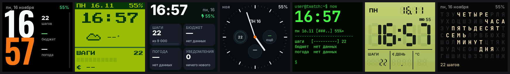

</div>

> Screenshots are taken from the real device over Wi-Fi (`GET /screenshot`). The on-watch UI language is **Russian** (see [Language](#language)).

## Contents
- [Hardware](#hardware)
- [Features](#features)
- [Screenshots](#screenshots)
- [Install](#install)
- [Configure and customize](#configure-and-customize)
- [Using the watch](#using-the-watch)
- [Battery life](#battery-life)
- [Project layout and docs](#project-layout-and-docs)
- [Roadmap](#roadmap)
- [Contributing](#contributing) · [License](#license) · [Credits](#credits)

## Hardware

| | |
| --- | --- |
| **Device** | [LilyGO T-Watch S3](https://lilygo.cc/products/t-watch-s3) (2023+, ESP32-S3, 16 MB flash, 8 MB PSRAM) |
| **Tested variant** | SX1262 LoRa radio (868 MHz), BMA423 accelerometer |
| **Display / touch** | 1.54" 240×240 ST7789, FT6336U capacitive touch |
| **Also on board** | AXP2101 PMIC, PCF8563 RTC, DRV2605 haptics, IR LED, speaker + PDM mic (unused) |

Not for the T-Watch 2020/2021, T-Watch S3 Plus or T-Watch Ultra (different hardware). Other radio variants of the T-Watch S3 and BMA456 accelerometer batches should build, but are **untested**.

## Features

**Watch faces** (long-press the face or pick one in Settings)
- Big digits, Game Boy, Dashboard, Analog, Terminal, 90s LCD, Word clock.
- Each face is one small module: easy to delete or add your own.

**iPhone notifications over Bluetooth LE — no companion app** ([details](docs/ble.md))
- Uses Apple's built-in ANCS: pair the watch once in iOS *Settings → Bluetooth*.
- List of the last 20 notifications, full-screen card on arrival, unread counter on the "Big digits" face.
- Swipe a notification left/right (or tap *Delete*) to dismiss it — it is removed on the iPhone too.
- Incoming calls: caller screen with **Decline / Accept**, strong repeating vibration.
- Per-app vibration patterns (Telegram, WhatsApp, Slack, Mail, Calendar, …), quiet nights (only calls vibrate).
- Latin, Cyrillic (incl. Serbian) and monochrome emoji in notification text.

**Everyday watch**
- Hardware step counter with a 7-day chart.
- Time from the RTC, corrected over Wi-Fi via NTP; 12 selectable time zones with DST.
- Wake by tap, crown or wrist raise; per-setting control of each.
- On-watch settings: brightness, screen timeout, step goal, notifications on/off, night power save, wrist/tap wake, vibration strength, face, time zone, time sync.

**Power**
- Screen off → ESP32-S3 light sleep. With notifications on, the ESP-IDF power manager sleeps between BLE events while the iPhone link stays up.
- **Night power save** (22:30–07:30, switchable): Bluetooth off, deeper sleep, dim short screen.
- Tuned by measurements: LVGL frame pacing, 80/240 MHz CPU scaling, LoRa radio asleep, touch auto-monitor, audio drivers not started ([power report](docs/power/README.md)).

**Developer friendly**
- **Wi-Fi OTA**: put the watch on any charger and upload a new build with one command; automatic rollback if a new build fails to boot 3 times.
- HTTP diagnostics on the charger: screenshots, logs that survive resets, hourly power stats, crash dumps, fake notifications for UI testing.
- Pure logic (ANCS protocol, steps, time, battery estimate) unit-tested on the host.

## Screenshots

| | | | |
| :---: | :---: | :---: | :---: |
| 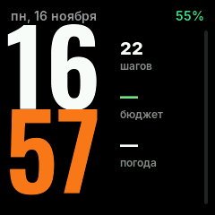<br>Big digits | 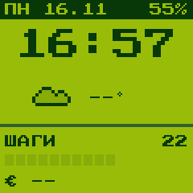<br>Game Boy | 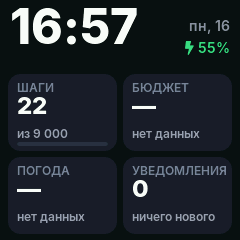<br>Dashboard | 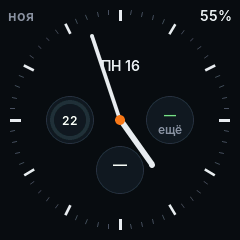<br>Analog |
| 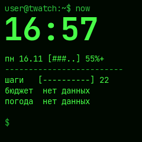<br>Terminal | 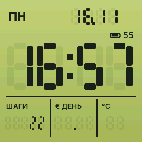<br>90s LCD | 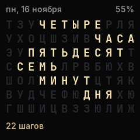<br>Word clock | 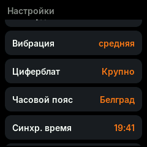<br>Settings |
| 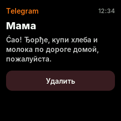<br>Notification | 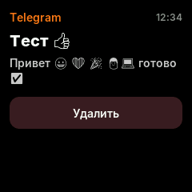<br>Emoji in text | 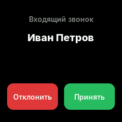<br>Incoming call | |

## Install

There is no prebuilt binary yet: Wi-Fi credentials are compiled in, so you build your own (≈10 minutes the first time).

### 1. Prerequisites
- macOS or Linux (Windows via WSL should work, untested).
- [PlatformIO Core](https://docs.platformio.org/en/latest/core/installation/index.html). The pinned [pioarduino](https://github.com/pioarduino/platform-espressif32) platform needs **Python 3.10–3.14**. Easiest: install [uv](https://docs.astral.sh/uv/) and the scripts run `uvx --python 3.13 --from platformio pio` for you.
- A USB data cable (the T-Watch S3 has a **Micro-USB** port).

### 2. Back up the stock firmware (recommended)
```sh
scripts/backup-flash.sh            # full 16 MB image to ~/twatch-backups/, with a .sha256
```
Restore any time with `scripts/restore-flash.sh <image.bin>`. The official LilyGO factory image is linked in [docs/flashing.md](docs/flashing.md).

### 3. Configure
```sh
scripts/setup.sh                   # asks for Wi-Fi SSID/password and an OTA password
```
It writes `firmware/include/secrets.h` and `firmware/ota_secrets.ini` (both gitignored). Wi-Fi is optional but needed for time sync (NTP) and wireless updates.

### 4. Build and flash over USB
```sh
scripts/flash_usb.sh               # builds and flashes; the port is found automatically
```
If no port shows up, enter download mode: hold **BOOT**, short-press the crown, release BOOT after 2–3 s ([details](docs/flashing.md)).

### 5. Pair your iPhone
On the iPhone open *Settings → Bluetooth*, tap **twatch** and confirm pairing. Notifications start arriving within seconds.

### 6. Later updates over Wi-Fi
Put the watch on a charger (same Wi-Fi network) and run:
```sh
firmware/tools/ota_upload.sh       # build + upload + verify; SKIP_BUILD=1 to upload the last build
```

## Configure and customize

| What | Where |
| --- | --- |
| Wi-Fi, OTA password | `scripts/setup.sh` → `firmware/include/secrets.h`, `firmware/ota_secrets.ini` |
| Time zones offered in Settings | `firmware/lib/core/local_time.h` (`kZones`, POSIX TZ strings) |
| Night window (quiet + power save) | `firmware/src/app/modes.cpp` (`kNight`) |
| Vibration pattern per app | `firmware/lib/core/ancs.cpp` (`hapticFor`, `kApps` names) and `firmware/src/hw/haptics.cpp` |
| Brightness levels, timeouts, defaults | `firmware/src/app/settings.h` |
| Add / remove a watch face | `firmware/src/ui/faces/` + registry in `faces.cpp` |
| Fonts and glyph ranges | `firmware/tools/fonts/gen.sh` (OFL fonts → LVGL C fonts) |
| UI texts | `firmware/src/ui/ui.cpp` and the faces |

Everything else (build details, HTTP API, hardware quirks) is in [docs/dev-workflow.md](docs/dev-workflow.md).

### Language
The UI strings are Russian (Cyrillic fonts, Russian dates and the word clock). Translations are welcome — see [CONTRIBUTING.md](CONTRIBUTING.md). Notification text from your phone is shown as-is in any Latin or Cyrillic script.

## Using the watch

```
            [notifications]
[settings]      [face]       [steps + system info ↓]
```
- **Swipe** from the face: up → notifications, left → settings, right → steps (scroll down for battery, iPhone link, firmware).
- **Long-press** the face → next watch face.
- **Crown** → screen on/off. **Tap** or **raise your wrist** → screen on.
- In the notification list: tap to open, swipe sideways to dismiss.

## Battery life

470 mAh battery. Measured so far on one unit (details and method in [docs/power/README.md](docs/power/README.md)):

| Mode | Average draw | Runtime |
| --- | --- | --- |
| Notifications off, screen mostly off | ~7 mA in sleep | ~2.5–3 days |
| Notifications on, normal wear | ~15 mA | ~30 h |

Notification-mode draw is being investigated with the hourly stats (`GET /stats`); night power save is new and expected to help.

## Project layout and docs

```
firmware/            PlatformIO project
  src/hw/            board services: power & sleep, notifications (BLE/ANCS), OTA + HTTP API, clock, motion, haptics
  src/ui/            LVGL screens and watch faces (src/ui/faces)
  src/app/           settings, night mode
  lib/core/          pure logic with host unit tests (ANCS protocol, steps, local time, …)
  tools/             OTA upload, font generator, build info
scripts/             setup, USB flash, flash backup/restore
docs/                developer documentation (below)
```

| Document | About |
| --- | --- |
| [docs/dev-workflow.md](docs/dev-workflow.md) | build, OTA, rollback, HTTP API, verified hardware quirks, watchdogs — **read before hacking** |
| [docs/ble.md](docs/ble.md) | iPhone notifications: ANCS, BLE in light sleep, design |
| [docs/power/README.md](docs/power/README.md) | power measurements and optimizations |
| [docs/flashing.md](docs/flashing.md) | download mode, backup, restore, factory image |
| [docs/adr/](docs/adr/) | architecture decision records |
| [docs/GLOSSARY.md](docs/GLOSSARY.md) | terms used in code and docs |

Run the host tests:
```sh
uvx --python 3.13 --from platformio pio test -d firmware -e native
```

## Roadmap
- Investigate notification-mode power draw (hourly stats are in).
- Wrist-gesture sensitivity setting (own tilt detection on top of the BMA423 feature).
- TOTP codes, Home Assistant scene buttons, IR remote, time via iPhone (BLE CTS).
- Optional companion server (weather, budget, calendar) — not started.

Ideas and bug reports are welcome in [issues](https://github.com/gpont/twatch-s3/issues).

## Contributing
Pull requests are welcome! Please read [CONTRIBUTING.md](CONTRIBUTING.md). Security issues: see [SECURITY.md](SECURITY.md).

## License
[MIT](LICENSE). Bundled fonts and libraries keep their own licenses — see [THIRD_PARTY_NOTICES.md](THIRD_PARTY_NOTICES.md).

## Credits
- [LilyGoLib](https://github.com/Xinyuan-LilyGO/LilyGoLib) (board support) and [LilyGO](https://lilygo.cc/) for the hardware.
- [LVGL](https://lvgl.io/), [NimBLE-Arduino](https://github.com/h2zero/NimBLE-Arduino), [SensorLib](https://github.com/lewisxhe/SensorLib), [RadioLib](https://github.com/jgromes/RadioLib), [ArduinoJson](https://arduinojson.org/), [pioarduino](https://github.com/pioarduino/platform-espressif32).
- Fonts: Inter, Oswald, JetBrains Mono, Press Start 2P, Unbounded, Noto Emoji (SIL OFL) and Font Awesome.

*Not affiliated with LilyGO or Apple. iPhone is a trademark of Apple Inc.*
